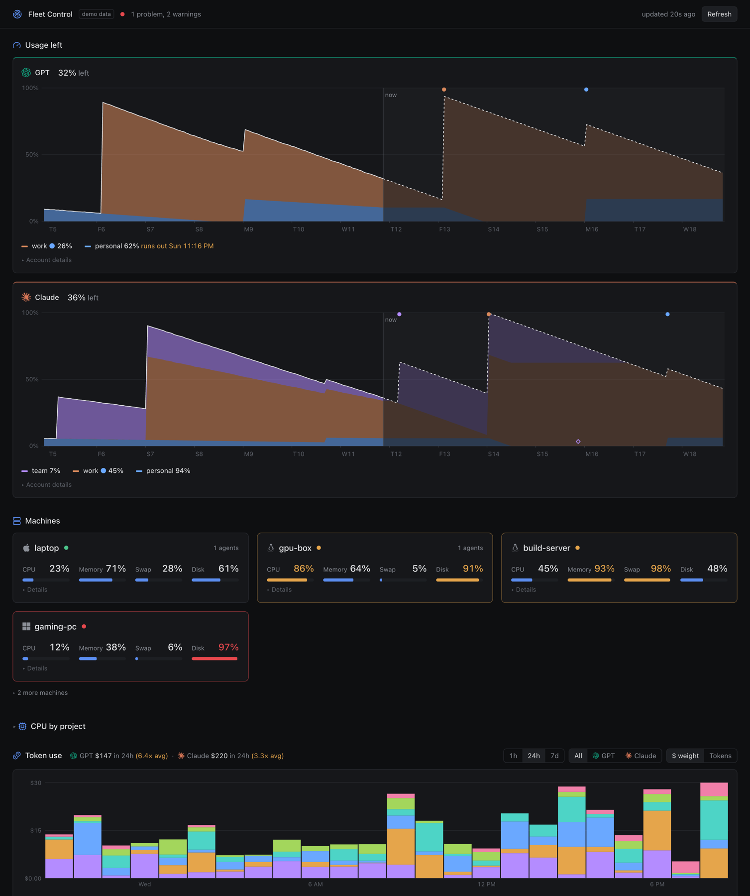

# Fleet Control

One page that tells you, in one look, if your coding-agent setup is healthy:

- **Usage left:** all your ChatGPT and Claude subscriptions pooled per provider, with a 7-day projection that includes every weekly reset. You see when the pool runs dry before it does.
- **Machines:** CPU, memory, swap and disk of every box you run agents on (Mac, Linux, Windows), with the project and process behind each number, and real swap-thrashing detection.
- **Token use:** which project, thread and model burns your quota, across Codex and Claude Code on all machines.
- **Problems:** one list, worst first, with the cause and often a command to fix it.

**Live demo with made-up data:** https://fleetcontrol.andrewting.dev

No agents to install, no database, no build step and no dependencies: Python 3.11 standard library on the
machine that runs the server, and SSH to the others. Hosts need only Python 3.6 (or PowerShell on Windows).
The probes are streamed over SSH, so nothing is installed on the hosts.

## Try it

~~~sh
git clone https://github.com/andrewting19/fleet-control && cd fleet-control
python3 fleet.py serve --demo        # made-up data
python3 fleet.py serve               # this machine and your Codex login, no config needed
~~~

Open http://localhost:10400.

To share a screenshot, open `/?private=1`. The page then shows made-up names for
machines, accounts, projects, folders and threads. The numbers stay real.

`python3 fleet.py export-demo DIR` writes a static copy with made-up data, for GitHub Pages or any file host.

## Set it up for your machines

Give the repo to your coding agent and say:

> Read AGENTS.md and set up Fleet Control for my machines and accounts.

The agent finds your SSH hosts and agent logins, writes `config.toml`, runs the checks, and installs the service.
If you prefer to do it yourself:

1. `cp config.example.toml config.toml` and add your machines and account sources.
2. `python3 fleet.py check` runs each collector once and tells you what works.
3. `python3 fleet.py projects` shows your busiest working folders, so you can add project rules.
4. `python3 fleet.py service install` starts it at login (launchd on macOS, systemd on Linux).

## What it reads

| Data | Source |
| --- | --- |
| Machines | `probes/host_probe.py` over SSH (Linux, macOS), `probes/win_probe.ps1` over SSH (Windows), Tailscale status for the rest |
| Token use | Codex session logs (`~/.codex/sessions`) and Claude Code transcripts (`~/.claude/projects`) on each host with `scan = true` |
| GPT quota | the Codex login: Codex writes the account's rate limits into its session logs |
| Claude quota | the Claude Code login (experimental), or your own source |
| Many accounts | a router such as opencodex, or any program that prints JSON (`docs/plugins.md`) |

Cost on the page is "$ weight": tokens x API list price. Subscriptions do not bill it, but it shows which work
uses the most quota.

## How the numbers work

- **CPU** is the share of CPU time in use, averaged over 1 minute. Linux load also counts tasks that wait for
  disk, so a CPU problem needs both high load and high CPU use. Disk wait has its own warning.
- **Memory** is memory that apps cannot get back without swapping: MemAvailable on Linux, Activity Monitor's
  "Memory Used" on macOS, available bytes on Windows.
- **Swap thrashing** is not "swap is full". It is a machine that keeps reading pages back from swap so work stalls:
  memory pressure (PSI) on Linux, swap-in rate on macOS, page reads with low free memory on Windows. The problem
  line names the process that holds the most memory and gives a kill command to copy.
- **Disk** % counts space reserved for root as used, because normal programs cannot use it.
- **Usage pool:** each account is a band sized by its plan (for example Pro = 5 x Plus). The projection drains the
  pool at the recent rate (or the week average, if higher), from the account that resets first, and adds each
  account's share back at its reset.
- **Tokens** come from the session logs that Codex and Claude Code write on each machine: every request's input
  (uncached, cache read, cache write) plus output, counted once. Calls that leave no session log are not seen:
  `claude -p` or SDK scripts that do not save sessions, and a few internal calls such as context compaction.
- **$ weight** is tokens x API list price (`fleetctl/prices.toml`), including the higher price for large prompts
  and for 1-hour cache writes. Subscriptions do not bill it; it shows which work is expensive.

## Security

The server binds to `127.0.0.1` by default. With `bind = "0.0.0.0"`, only clients in `allow` get an answer
(default: this machine and Tailscale). It only reads: it never logs in, spends resets or changes a host.
The page shows process command lines and folder paths, so do not expose it to the internet.

## Agent jobs

Agents often start batch work with nohup or '&' over SSH. Such a job has no owner, no memory limit and no queue, and
several of them can push a machine into swap thrashing. jobs/job.py is a single file with no dependencies (Python 3.9+,
Linux, macOS and Windows):

    ssh HOST job run --project P --owner "$CODEX_THREAD_ID" --peak-gb 4 -- python train.py
    job ls | job logs ID | job wait ID --timeout 600 | job stop ID

Each job outlives the shell, waits until the machine has --peak-gb free, stops at --mem-gb (Linux: cgroup MemoryMax in
agentjobs-<project>.slice under a capped agentjobs.slice; Windows: a Job Object; macOS: an RSS watchdog), runs at low
CPU priority, and records owner, exit code and peak memory in ~/.agentjobs/. On Linux, install it with
'sudo python3 jobs/job.py install --high-gb G --max-gb M'. Fleet Control shows the jobs of each machine and warns when
a job is killed, with the owner thread. Add the rule to your agents' global AGENTS.md or CLAUDE.md, so that they use it.

## Extend it

`docs/plugins.md` describes the account source JSON, Python sources, title sources, and how to read another
agent's logs. Tests: `python3 -m unittest discover tests`.

## License

MIT
